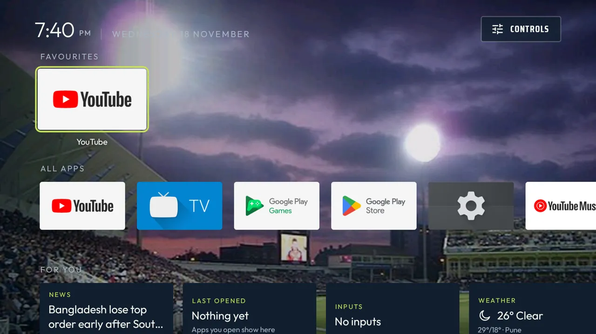
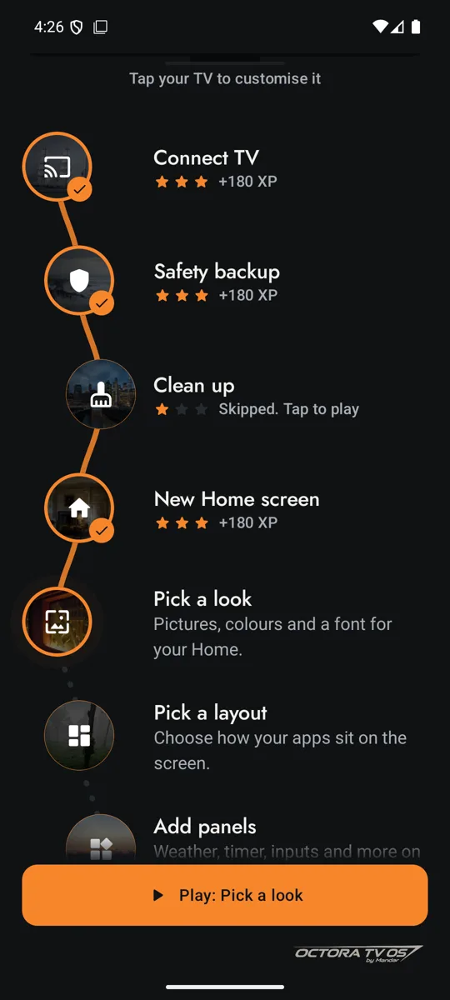
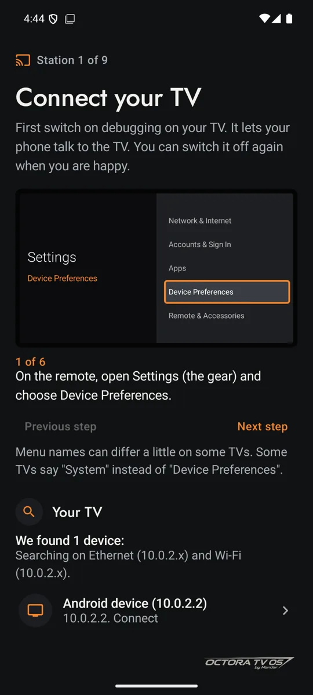
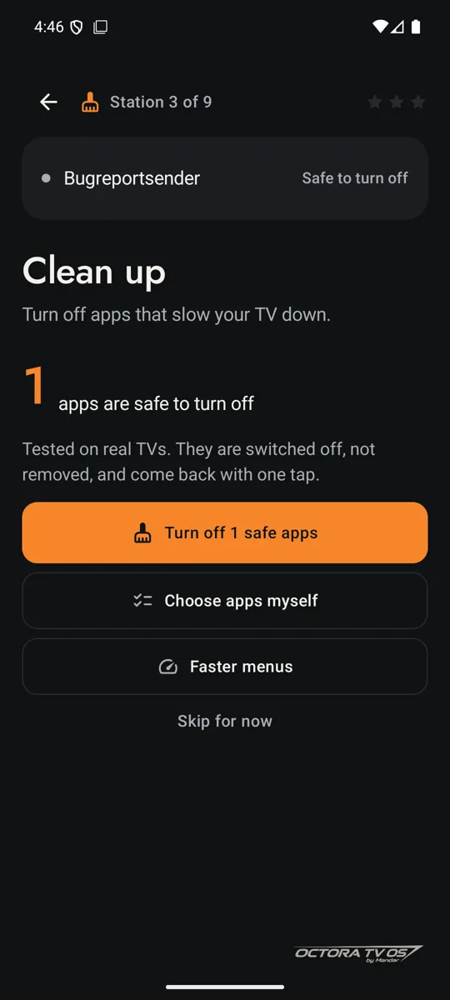

<p align="center">
  
</p>

<h1 align="center">OCTORA TV OS</h1>

<p align="center">
  <b>Fix your Android TV from your phone.</b><br>
  No PC. No cables. No technician. Everything can be undone.
</p>

<p align="center">
  <a href="https://github.com/mandarcasm/octora-tv-releases/releases/latest/download/OCTORA-TV-OS.apk"></a>
  <a href="https://github.com/mandarcasm/octora-tv-releases/releases/latest"></a>
  <a href="https://github.com/mandarcasm/octora-tv-releases/releases"></a>
</p>

<p align="center">
  <a href="https://mandarcasm.github.io/octora-tv-releases/"><b>Download page with install steps →</b></a><br><sub>Designed and developed by Mandar Kadam</sub>
</p>

---

## Why it exists

Cleaning up a smart TV (switching off the pre-installed apps that slow it down and push adverts, and fixing the
home screen) normally needs three things: **a PC with cables, someone who knows ADB, and that person standing in
front of the TV.** We set up TVs for people and kept hitting the same wall: we can't be in every home.

So we put the whole toolkit in a phone app. You do it yourself, at home, in a few minutes.

## What it does

| | |
|---|---|
| **Clears the clutter** | Switches off pre-installed apps that slow the TV and push adverts. Your own apps stay. |
| **A cleaner, faster Home screen** | Your favourite apps first, no sponsored rows. |
| **Make it yours** | 14 original looks, 15 Faith looks, 8 layouts, clock, weather, festivals. |
| **Your own pictures** | Share pictures to OCTORA from Gallery, Chrome or WhatsApp. One set all day or separate morning / evening / night sets; a new picture every time you come back to Home, on a timer, or one a day. |
| **Kids mode** | Only the apps you pick, with a PIN for settings. |
| **Safety backup first** | Saves your TV's setup before anything changes. |
| **Restore everything** | One button puts the TV back exactly as it was. |

<p align="center">
  
  
</p>

<p align="center">
  
  
  
  
</p>

## Install (on your phone)

1. **Download** [`OCTORA-TV-OS.apk`](https://github.com/mandarcasm/octora-tv-releases/releases/latest/download/OCTORA-TV-OS.apk).
   Opening the link from Instagram? Tap **⋮ → Open in browser** first: Instagram's browser can't download apps.
2. **Allow the install:** open the file, tap **Settings → Allow from this source**, go back, tap **Install**.
   If Play Protect asks, tap **More details → Install anyway**.
3. **On the TV:** Settings → Device Preferences → About → click **Build** 7 times → Developer options →
   turn on **USB debugging** (and **Network debugging** if shown).
4. **Connect:** phone and TV on the same Wi-Fi. Open OCTORA, tap **Start**, press **Allow** on the TV.

You can switch debugging off again when you're done. Turn it back on any time you want to change or restore something.

**Needs:** an Android phone (Android 8+) and an Android TV / Google TV (Mi / Xiaomi, Redmi, Acer, Croma,
Skyworth, TCL, Vu and others). Not for Samsung (Tizen), LG (webOS) or other non-Android TVs.

## Safe by design

- Never roots the TV, never deletes system apps. Apps are **switched off**, and can be switched back on.
- A **backup** is saved before every change; **Restore everything** undoes it all.
- Keeps the things your TV needs: Play Store, keyboard, voice, Chromecast, HDMI and tuner inputs.
- **No account, no tracking, no ads.** The app only talks to your TV on your home network, and asks GitHub
  whether a newer version exists. See [PRIVACY.md](PRIVACY.md).

## Why no character, movie or brand themes?

Those pictures belong to their owners, so we can't ship them in a public app. OCTORA comes with its own original
looks, and the **Customise** studio lets you load **your own pictures** from your phone and build any look you
like for your own TV.

## Updates

The app isn't on the Play Store, so it checks this page for new versions itself and shows a **Download** banner
when one is ready. Install it over the old one: your TV and your choices stay as they are.

## Verify your download

Every APK is signed with the same release key. Each release lists the file's SHA-256 checksum, and a
`.sha256` file is attached. On a PC:

```
certutil -hashfile OCTORA-TV-OS.apk SHA256      # Windows
sha256sum OCTORA-TV-OS.apk                      # macOS / Linux
```

## Help

Stuck on a step? [Open an issue](https://github.com/mandarcasm/octora-tv-releases/issues/new/choose) with your TV
model and the screen you're on, or message us on Instagram [@meetyourreach](https://instagram.com/meetyourreach).

---

<p align="center"><sub>OCTORA TV OS · Designed and developed by <b>Mandar Kadam</b> · <a href="https://www.meetyourreach.com">MeetYourReach</a> · This repository holds releases only. © 2026 All rights reserved.</sub></p>
