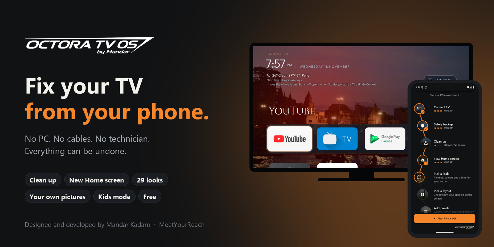
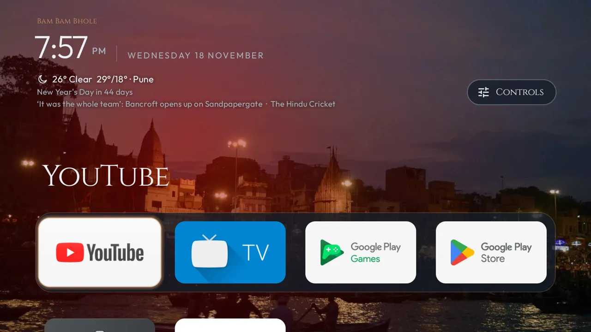
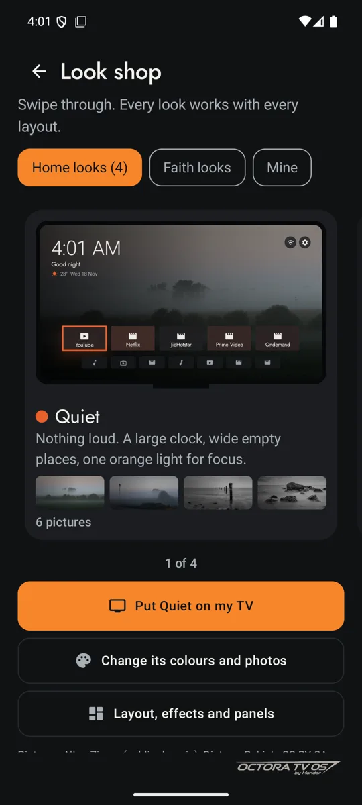
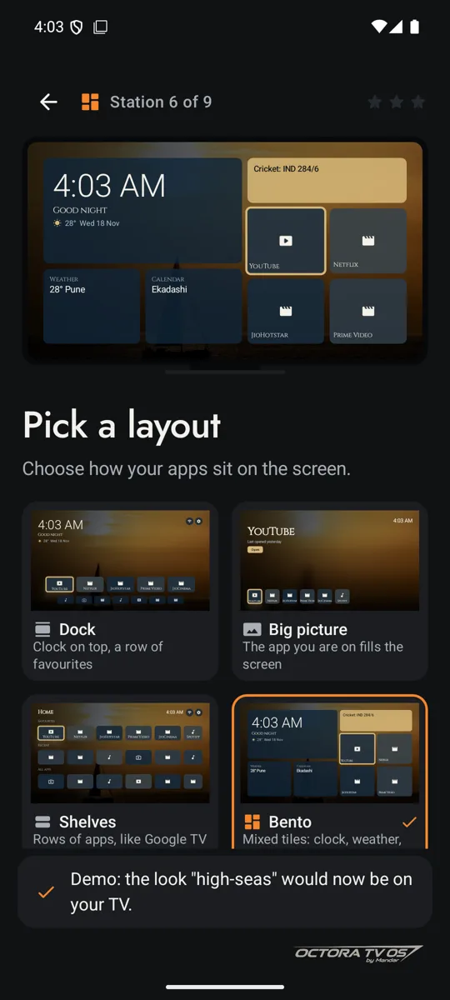
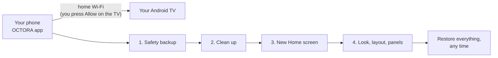

<p align="center">
  
</p>

<p align="center">
  <a href="https://github.com/mandarcasm/octora-tv-releases/releases/latest/download/OCTORA-TV-OS.apk"></a>
</p>

<p align="center">
  <a href="https://github.com/mandarcasm/octora-tv-releases/releases/latest"></a>
  <a href="https://github.com/mandarcasm/octora-tv-releases/releases"></a>
  
  
  
</p>

<p align="center">
  <a href="https://mandarcasm.github.io/octora-tv-releases/"><b>Install guide</b></a> ·
  <a href="#what-it-does"><b>Features</b></a> ·
  <a href="#install-in-4-steps"><b>Install</b></a> ·
  <a href="#questions"><b>FAQ</b></a> ·
  <a href="https://github.com/mandarcasm/octora-tv-releases/issues/new/choose"><b>Get help</b></a>
</p>

<br>

## The problem

Smart TVs ship slow and full of clutter: sponsored rows, pre-installed apps you never asked for, adverts on the
home screen. Cleaning that up has always needed three things:

| Before OCTORA | With OCTORA |
|:--|:--|
| ~~A laptop and cables~~ | **Just your phone**, over your home Wi-Fi |
| ~~Someone who knows ADB commands~~ | **Nine short stations**, one job each, in plain words |
| ~~That person standing in front of your TV~~ | **From your sofa**, whenever you like |

We set up TVs for people by hand and kept hitting the same wall: we can't be in every home. So we put the whole
toolkit in one phone app.

## What it does

<table>
<tr>
<td width="50%" valign="top">

**Clears the clutter**<br>
Switches off pre-installed apps that slow the TV down and push adverts. Your own apps stay.

**A cleaner, faster Home screen**<br>
Your favourite apps first, no sponsored rows, one press of Home and you're there.

**29 ready looks**<br>
14 original looks (Cosmos, Monsoon, Himalaya, Cricket Night, Zen Garden…) and 15 Faith looks
(Shiva, Ganesha, Krishna, Devi, Islam, Christianity, Sikhism, Buddhism and more).

</td>
<td width="50%" valign="top">

**Your own pictures**<br>
Share pictures to OCTORA from Gallery, Chrome or WhatsApp. A new one every time you come back to Home, on a
timer, or one a day. Separate morning, evening and night sets if you like.

**Kids mode**<br>
Only the apps you pick, with a PIN for settings.

**Safety first**<br>
A backup before every change, and one **Restore everything** button that puts the TV back exactly as it was.

</td>
</tr>
</table>

<p align="center">
  
  
</p>

<p align="center">
  
  
  
  
  
</p>

## How it works



The phone talks to the TV the same way a technician's laptop would (Android's debugging connection), but every
step is a button, every change is backed up first, and nothing is ever deleted or rooted.

## Install in 4 steps

> **Opening this from Instagram?** Tap **⋮ → Open in browser** first. Instagram's browser can't download apps.

1. **Download** [`OCTORA-TV-OS.apk`](https://github.com/mandarcasm/octora-tv-releases/releases/latest/download/OCTORA-TV-OS.apk) on your **phone**.
2. **Allow the install:** open the file → **Settings** → **Allow from this source** → back → **Install**.
   If Play Protect asks, tap **More details → Install anyway**.
3. **On the TV:** Settings → Device Preferences → About → click **Build** 7 times → Developer options →
   turn on **USB debugging** (and **Network debugging** if you see it).
4. **Connect:** phone and TV on the same Wi-Fi. Open OCTORA, tap **Start**, press **Allow** on the TV.

Done for the day? You can switch debugging off again. Turn it back on whenever you want to change or restore something.
The [install guide](https://mandarcasm.github.io/octora-tv-releases/) has the same steps with pictures.

## Questions

<details>
<summary><b>Is it safe? Can it break my TV?</b></summary>
<br>
OCTORA never roots the TV and never deletes system apps. It switches apps off (they can be switched back on), saves
a backup before every change, and keeps what your TV needs: Play Store, keyboard, voice, Chromecast, HDMI and tuner
inputs. <b>Restore everything</b> puts the TV back as it was.
</details>

<details>
<summary><b>Which TVs does it work with?</b></summary>
<br>
Android TV and Google TV sets and boxes: Mi / Xiaomi, Redmi, Acer, Croma, Skyworth, TCL, Vu, OnePlus, Realme,
Sony and others. Not Samsung (Tizen), LG (webOS) or other non-Android TVs.
</details>

<details>
<summary><b>Why are there no character, movie or brand themes?</b></summary>
<br>
Those pictures belong to their owners, so we can't ship them in a public app. OCTORA comes with its own original
looks, and you can share <b>your own pictures</b> into the app to build any look you like for your own TV.
</details>

<details>
<summary><b>Why isn't it on the Play Store? How do I get updates?</b></summary>
<br>
We release it here so fixes reach you quickly. The app checks this page itself and shows a <b>Download</b> banner
when a new version is ready. Install it over the old one: your TV and your choices stay as they are.
</details>

<details>
<summary><b>Does it collect my data?</b></summary>
<br>
No account, no tracking, no ads. The app talks only to your TV on your home network, and asks GitHub whether a newer
version exists. See <a href="PRIVACY.md">PRIVACY.md</a>.
</details>

<details>
<summary><b>How do I check the download is genuine?</b></summary>
<br>
Every APK is signed with the same OCTORA release key, and each release lists its SHA-256 checksum (also attached as a
<code>.sha256</code> file).

```
certutil -hashfile OCTORA-TV-OS.apk SHA256      # Windows
sha256sum OCTORA-TV-OS.apk                      # macOS / Linux
```
</details>

## Who made it

<table>
<tr>
<td width="140" valign="top"></td>
<td valign="top">

**Mandar Kadam** · designer and developer of OCTORA TV OS<br>
CTO, [MeetYourReach](https://www.meetyourreach.com) & Pranav Wadkar Group

OCTORA started with setting up TVs for people by hand, one home at a time, with a laptop and cables. Mandar
designed and built the app so anyone can do the same job themselves from their phone.

> *"I believe technology should do more than solve immediate problems; it should create opportunities for what comes next."*

</td>
</tr>
</table>

## Help

Stuck on a step? [Open a help request](https://github.com/mandarcasm/octora-tv-releases/issues/new/choose) with your
TV model and the screen you're on, or message [@meetyourreach](https://instagram.com/meetyourreach) on Instagram.

---

<p align="center">
  <br>
  <sub><b>OCTORA TV OS</b> · Designed and developed by Mandar Kadam · <a href="https://www.meetyourreach.com">MeetYourReach</a><br>
  This repository holds releases only. © 2026 All rights reserved.</sub>
</p>
